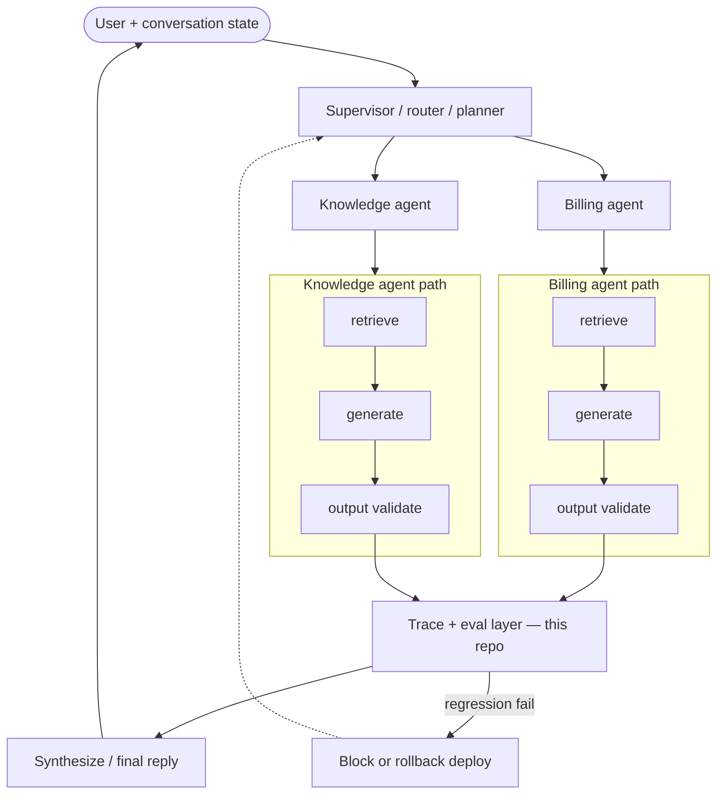

# Observability Strategies

**Reference implementation** of current **best practices** for **observability and offline evaluation** in RAG and multi-agent systems: golden datasets, retrieval-only benchmarks, answer quality metrics, fixture traces, incident investigation, and regression/canary gates—so you can **measure** quality before deploy and **attribute** failures to a layer.

The patterns match [AI-System-Architecturing-Engineering → observability-evaluation](https://github.com/CaioHAndradeLima/AI-System-Architecturing-Engineering/tree/main/observability-evaluation). This repo ships **recommended defaults** (layered eval strategies, `ci-observability-eval` scorecard, incident/canary fixtures) plus a **fixed regression corpus** so you can compare eval pipeline changes before pointing the same commands at production traces.

### Where observability runs (multi-agent stack)

Each agent path emits spans and eval rows; this repo implements the **trace + eval layer** (highlighted)—offline first, CI-gated. Supervisor merge and deploy pipelines are yours; pair with [deployment pipeline evaluation](https://github.com/CaioHAndradeLima/AI-System-Architecturing-Engineering/blob/main/deployment/pipeline-evaluation.md) for promote/rollback.



---

## 1. What is observability/eval in a multi-agent system?

**Observability** is structured traces, metrics, and logs that tie each user request to retrieval, context, generation, tools, and validation steps. **Evaluation** is repeatable scoring on golden datasets (retrieval qrels, answer rubrics, output checks) plus canary comparison against a baseline.

Upstream [contexting-strategies](https://github.com/CaioHAndradeLima/contexting-strategies) and [output-strategies](https://github.com/CaioHAndradeLima/output-strategies) cover assembly and post-LLM validation semantics; this repo orchestrates **retrieval → answer → trace rollups** on fixture runs and documents tool/platform choices without shipping vendor tenants.

Typical position:

```text
Retrieve → assemble → generate → validate → reply
     ↑______________ trace + golden eval ______________↑   ← this repo
```

---

## 2. Guarantee measurable quality — mechanisms

You **measure and gate** eval pipelines against labeled goldens—not hope dashboards look fine.

| Mechanism | What it checks | Reference implementation |
| --- | --- | --- |
| **Retrieval-only metrics** | Recall@K, nDCG@K, labeled hit rate | `retrieval_metrics.py` |
| **Poor retrieval routing** | Next fix branch from retrieval scores | `poor_retrieval.py` |
| **Answer quality** | Groundedness, abstain, citation ⊆ retrieved | `answer_metrics.py` |
| **Trace parse + rollups** | Span tree, latency/cost/token aggregates | `tracing.py`, `tracing_metrics.py` |
| **Incident investigation** | Top-down layer hypothesis from spans | `failure_investigation.py` |
| **Canary/regression** | Candidate vs baseline metric bundle | `regression_canary.py` |
| **Eval strategies** | `retrieval_only` vs `e2e_offline` vs `judge_augmented` | `strategies.py`, `eval_pipeline.py` |

**Recommended check on every change:**

```bash
python -m observability_strategies.cli evaluate-pipeline --profile ci-observability-eval --output reports/pipeline-eval.json
python -m observability_strategies.cli check-measure --profile ci-observability-eval --report reports/pipeline-eval.json
```

---

## 3. Avoid blind spots

| Risk | Mitigation in this repo |
| --- | --- |
| **Cost/latency drift** | `tracing_metrics` rollups on fixture spans; gate `max_mean_latency_ms` in CI profile |
| **PII in logs** | Synthetic fixtures only; production scrubbing listed in §8 |
| **Judge drift** | Offline rubrics in `llm_judge.py`; live path optional and skipped in CI |
| **False alarms** | Canary tolerances in `data/canary_baselines.json`; tune per release |

---

## 4. Loops

| Loop | Command |
| --- | --- |
| **PR / CI eval** | `evaluate-pipeline --profile ci-observability-eval` + GitHub `measure-gate` |
| **Canary** | `evaluate-scenarios` → `scenarios.canary` vs baseline JSON |
| **Incident** | `failure_investigation` on `data/incident_scenarios.json` |

---

## 5. Strategies / patterns (regression snapshot)

Local run on bundled goldens (`e2e_offline` strategy):

| Metric | Value |
| --- | ---: |
| Recall@5 | 0.875 |
| nDCG@5 | 0.875 |
| Groundedness rate | 0.875 |
| Citation alignment | 1.0 |
| Abstain correct | 0.875 |
| Incident layer match | 1.0 |
| Canary gate | pass |

Compare strategies: `python -m observability_strategies.cli evaluate --strategies retrieval_only,e2e_offline,judge_augmented`.

---

## 6. Metrics

Scorecard fields and scenario gates are documented in [docs/PIPELINE_EVAL.md](./docs/PIPELINE_EVAL.md). Full guide mapping: [docs/LAB_COVERAGE.md](./docs/LAB_COVERAGE.md) (**11/11**, `coverage.lab_coverage_percent` = 100).

---

## 7. Commands cheat sheet

| Command | Purpose |
| --- | --- |
| `evaluate-pipeline --profile ci-observability-eval` | PR scorecard (recommended gate) |
| `evaluate-full` | All guide keys + coverage block |
| `evaluate` | Strategy comparison on golden set |
| `evaluate-scenarios` | Poor retrieval, incident, canary fixtures |
| `measure --profile ci-all-strategies` | Multi-strategy measure report |
| `check-measure --profile … --report …` | Assert thresholds (exit 1 on fail) |
| `./scripts/docker-ci.sh ci-observability-eval` | Docker parity with CI |

Install: `pip install -e .` · CLI entrypoint: `observability-lab`.

---

## 8. Adopting in production

1. Replace `data/golden.json`, `data/runs.json`, and trace fixtures with exports from your warehouse (keep qrels and rubric labels).
2. Export **OpenTelemetry** spans to your backend separately; this repo parses **normalized JSON** trees for regression, not a live collector deploy.
3. Pair **[reranking-strategies](https://github.com/CaioHAndradeLima/reranking-strategies)**, **[contexting-strategies](https://github.com/CaioHAndradeLima/contexting-strategies)**, and **[output-strategies](https://github.com/CaioHAndradeLima/output-strategies)** for retrieval, assembly, and output validation metrics on the same golden rows.
4. Wire canary baselines from your release pipeline ([regression-and-canary-releases](https://github.com/CaioHAndradeLima/AI-System-Architecturing-Engineering/blob/main/observability-evaluation/regression-and-canary-releases.md)).

**Not included here (by design):** live LangSmith/Langfuse tenants, full OTel collector Helm charts, production metric warehouses, human review queues for judge calibration.

---

## 9. Development

```bash
python -m venv .venv && source .venv/bin/activate
pip install -e .
python -m unittest discover -s tests -v
./scripts/docker-ci.sh ci-observability-eval
```

- **Data:** `data/golden.json`, `data/traces.json`, `data/incident_scenarios.json`, `data/canary_baselines.json`, `data/runs.json`
- **CI:** [.github/workflows/measure-gate.yml](./.github/workflows/measure-gate.yml) matrix profiles
- **Docs series:** [AI-System-Architecturing-Engineering](https://github.com/CaioHAndradeLima/AI-System-Architecturing-Engineering)
